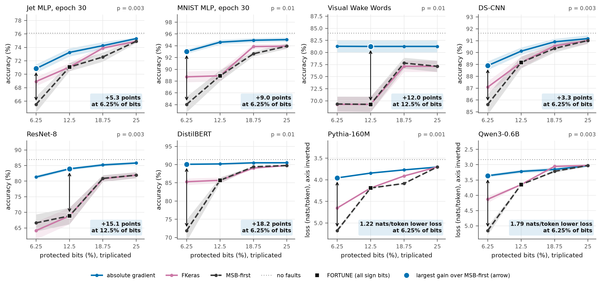
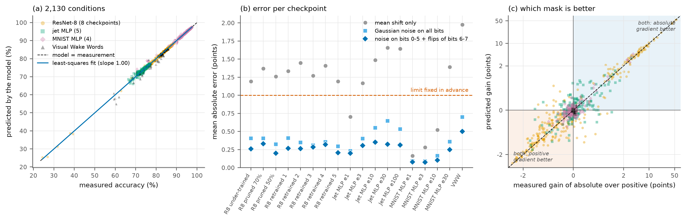
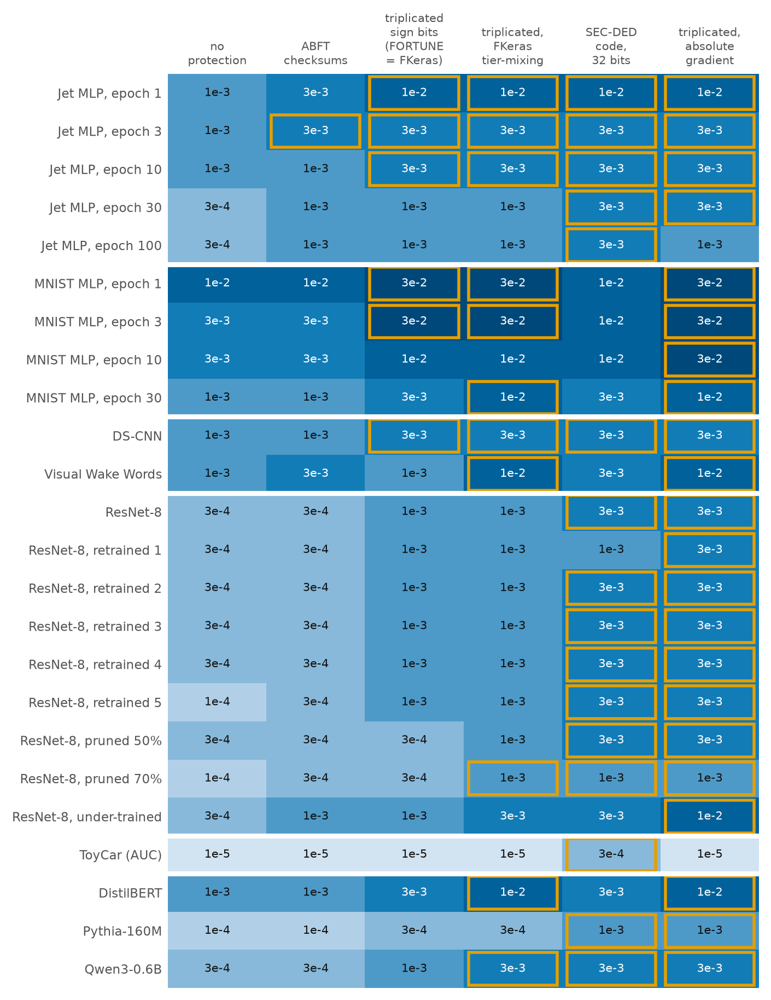

# NetSuRF

NetSuRF is a research framework for studying which stored weight bits of a quantized
neural network are worth protecting against bit flips. It freezes a model, builds
protection choices from calibration data, injects exact bit faults into the stored
INT8 weights, and compares the choices on the same random faults, in the task metric.

This repository holds the framework (`netsurf/`), the experiment scripts
(`workflows/`), and the manuscript *A Bit More Than Noise: Statistical Fault Analysis
for Budgeted Protection in Quantized Neural Networks* with its figures, data tables
and frozen analysis plans (`publications/paper1_review/`).

## Main results

All numbers are from the manuscript (draft v33, tag `paper1/delivery-v33`), on 24
trained INT8 models of nine architectures, from a 4,000-weight MLP to the
0.6-billion-parameter Qwen3. Every stored bit can fail, including the redundant
copies and check bits of the protection itself.



**1. Ranking bits by the size of their gradient effect protects better than ranking by
bit position.** Triplicating the bits with the largest per-example gradient effect
was compared with triplicating by bit position (MSB-first, as FORTUNE does for the
sign bit) and by the Hessian order of FKeras. Wherever a model was still usable it
was significantly better in 222 of the 859 conditions tested and significantly worse
in none, by up to 21 accuracy points on ResNet-8.

**2. A simple statistical model predicts what many simultaneous faults do.** The
faults that a protection choice leaves can be replaced by Gaussian noise on each
weight, with the exact mean and variance of its unprotected low bits, plus individual
flips of the two highest bits. With nothing fitted, this model reproduced measured
accuracy within 0.08 to 0.50 points on average on each of 18 models it was not
developed on, and picked the better of two protection choices in 437 of 443 cases.



**3. No fixed ranking is always best.** Rankings that also use the direction of a
flip help ResNet-8 when faults are rare, hurt when they are frequent, and leave two
of three language models worse than with no protection. On ResNet-8 the fault rate at
which the preference switches is predicted from calibration data before any fault is
injected; the measured preference agreed in 515 of 519 conditions away from the switch.

**4. The best protection mechanism depends on the model.** At similar storage cost,
triplicating ranked bits tolerates a higher fault rate than a SEC-DED code on 8 of
the 24 models, the code on 2, and they tie on 14. Checksum-based correction (ABFT) and
sign-bit triplication were never the best choice.



### What these results are not

- The study is software-only. Protection cost is counted in stored bits; voters,
  encoders, decoders, area and power are not priced.
- The bit-error probability is a model parameter. It is not a measured radiation
  upset rate.
- Detection is not correction, and a synthesis result is not fabricated silicon.
- The statistical model was checked on 18 small models, not on the language models,
  and against measurements that already existed when its pass criteria were written.
- The model matches the mean and variance of the low-bit disturbance; it has its
  shape only when faults are frequent (see Appendix E of the manuscript).

| Model family | Models | Stored weight bits | Task |
|---|---|---|---|
| Jet-tagging MLP | 5 | 34,048 | jet classification |
| MNIST MLP | 4 | 203,264 | digit classification |
| DS-CNN (MLPerf Tiny) | 1 | 176,128 | keyword spotting |
| ResNet-8 (MLPerf Tiny) | 9 | 618,880 | CIFAR-10 |
| VWW MobileNet (MLPerf Tiny) | 1 | 1,664,896 | visual wake words |
| ToyCar autoencoder (MLPerf Tiny) | 1 | 2,113,536 | anomaly detection |
| DistilBERT | 1 | 344,469,504 | SST-2 sentiment |
| Pythia-160M | 1 | 988,545,024 | WikiText-2 language modelling |
| Qwen3-0.6B | 1 | 4,767,875,072 | WikiText-2 language modelling |

## Where things are

| Path | Contents |
|---|---|
| `netsurf/` | The framework: exact bit identities and faults, rankings, protection mechanisms (`nonideal_protection.py`, `protection_analytic.py`), the statistical model's moments (`event_background.py`, `mean_variance.py`), benchmark adapters. Importing it has no side effects. |
| `workflows/` | Scripts that ran the experiments and analyses of the manuscript (`runT_*.py` is the main comparison). |
| `tests/` | Deterministic regression tests. |
| `publications/paper1_review/` | Manuscript source (`source/`), figures, the data tables behind them (`data/`), figure scripts (`scripts/`), and the plans that were fixed before each study (`review/`). |
| `config/` | Experiment configurations and asset registries. |
| `docs/` | Scientific contracts, milestone audits, protocols, and the [command-line guide](docs/CLI_GUIDE.md). |
| `tutorials/` | Maintained examples. |
| `DEPRECATED/` | The recovered 2025 implementation and notebooks. They are evidence, not the current specification; see `docs/LEGACY_MAPPING.md` before using them. |
| `workspace/` | Run outputs, caches and checkouts. Ignored by git. |

In the notes under `docs/` and `publications/`, machine paths are written with
placeholders: `<repo>` is this checkout, `<assets>` the folder with model and dataset
locks, `<netsurf-env>` the Python environment, `<home>` the home folder.

## Setup and tests

NetSuRF needs Python 3.11. The validated package versions are listed in
`dependencies/modern-ml-direct.txt`; `dependencies/MODERN_ML.md` explains the setup
and its acceptance checks.

```bash
python -m pip install --no-deps -e .
```

```bash
python -m pytest -q
```

The TFLite experiments of the manuscript use the TensorFlow Lite 2.14.1 reference
kernels, in a separate environment from the framework's default one; the versions are
in `publications/paper1_review/review/COMPUTE_ENVIRONMENT.md`.

## Storage configuration

Input datasets remain shared, while all new generated runs are local to the
ignored repository workspace. The Kona defaults are:

- `NETSURF_DATASET_ROOT=/ml/datasets`
- `NETSURF_WORKSPACE=<repo>/workspace`
- `NETSURF_LEGACY_SOURCE_ROOT=<repo>/DEPRECATED/legacy_source/netsurf`
- `NETSURF_QKERAS_ROOT=<repo>/DEPRECATED/external_links/qkeras`
- `NETSURF_LEGACY_WORKSPACE=<repo>/workspace/legacy`

Override these environment variables on another system. A reference layout is
provided in `config/storage.example.toml`.

## Running experiments

The command-line interface, the Python API and the tutorial share one engine:

```bash
netsurf doctor
```

```bash
netsurf benchmarks list
```

```bash
netsurf run config/experiments/numpy_reference.toml
```

Every finished run is an immutable folder with its configuration, provenance,
measurements, exact masks and fault schedules, checksums and a report. The
[command-line guide](docs/CLI_GUIDE.md) lists the commands for every kind of study,
and `docs/REPRODUCIBILITY.md` gives bounded commands with their expected digests.
Large campaigns are never started automatically.

## Reproducing the manuscript

- Each study has a plan in `publications/paper1_review/review/` that fixes its
  conditions, seeds and decision rules.
- The scripts in `workflows/` produce the run outputs; the scripts in
  `publications/paper1_review/scripts/` turn them into the tables in
  `publications/paper1_review/data/` and the figures.
- Run outputs (about 350 GB) are not in git. The data tables that the figures and
  the text use are, each with the hash of the outputs it was built from.
- Run times of every study are in Appendix C of the manuscript: 449 job-hours for
  the main comparison and 399 for the fault-rate study on a shared CPU server.

## Branches and tags

`v2` is the main line and contains all finished work. Earlier milestone branches
were retired on 2026-11-17: each survives as a tag `archive/<branch>`, so every
commit named in a run record still resolves. `paper1-tecs-revision-v1` and
`paper1-runR-v2-validated` stay as working branches until the manuscript is
submitted. `docs/BRANCH_CONSOLIDATION_PLAN.md` records what was done and why.

## Status and licence

This is research software; a licensing review is pending (`pyproject.toml`). The
manuscript is in preparation for ACM Transactions on Embedded Computing Systems.
